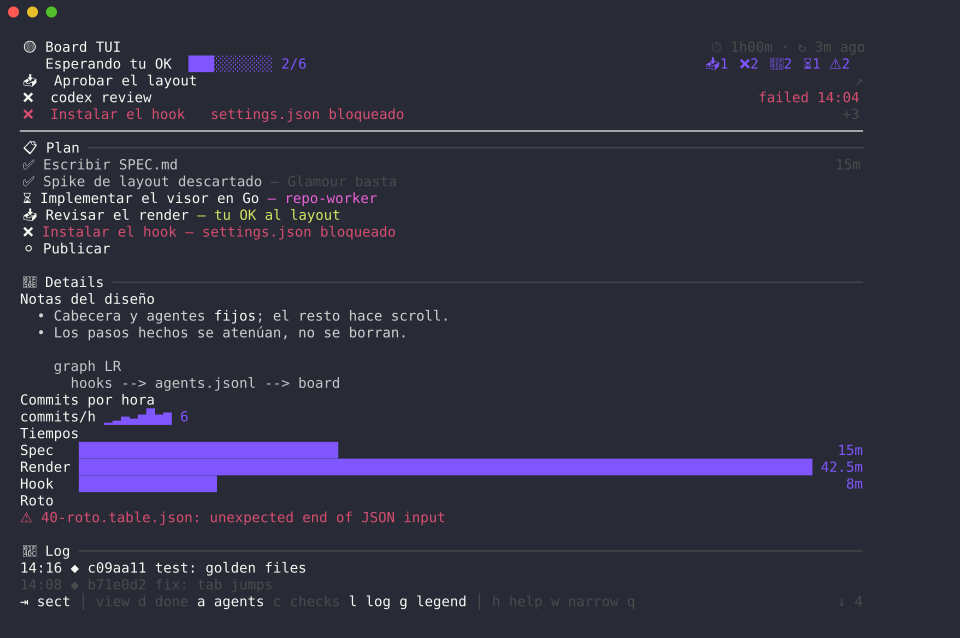
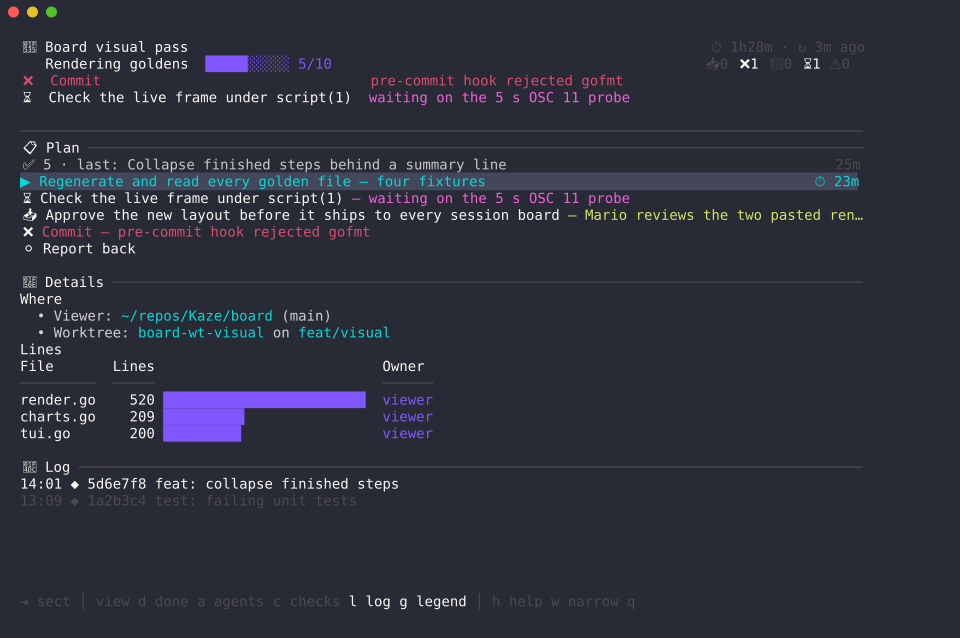
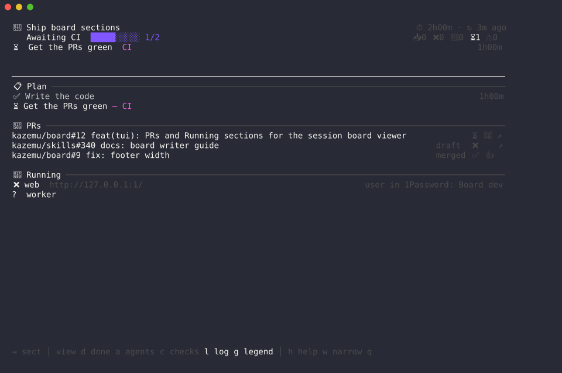
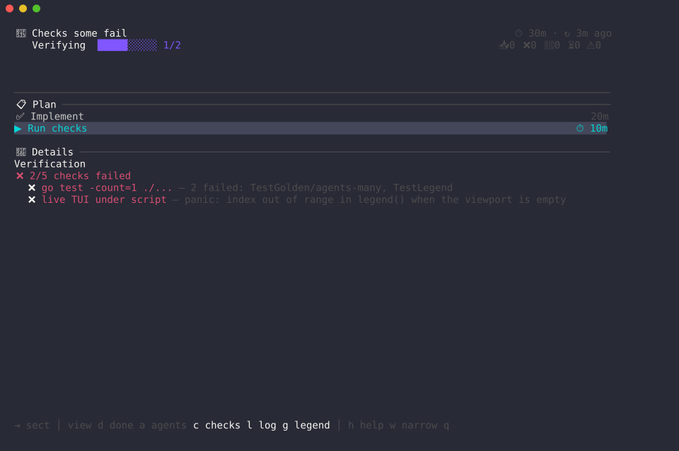

# AI Board

A read-only terminal viewer for Claude Code session boards. Claude and hooks write small files into `~/.claude/boards/<session-id>/`; `ai-board` watches that directory and renders what needs Mario (pending items) and running subagents at the top, then the plan, the PRs the task tracks, the local services it started (probed up or down), the sections (Markdown, charts, tables, checks) under Details, and a log.

The file formats, layout, keys and CLI are defined in [SPEC.md](SPEC.md).

## Screenshots

The live viewer on four boards from `testdata/`, in a 100x34 terminal.



Waiting on you: the header slots show the pending approval and the failures, and Details renders notes, a sparkline and a bar chart.



Mid-plan: finished steps collapse into one summary line, and the active step is highlighted with its elapsed time.



PRs with CI and review state, and the local services the task started, probed up or down.



A checks section: one red summary line, then only the failing checks.

## Install

```sh
go install github.com/MarioPayan/ai-board/cmd/ai-board@latest
```

From a clone:

```sh
GOBIN=$HOME/.local/bin go install ./cmd/ai-board
```

## Usage

```sh
ai-board                   # watch the newest board in ~/.claude/boards
ai-board <session-id>      # watch one session's board
ai-board path/to/board-dir # watch any board directory

ai-board --once --width 80 [--now 2026-10-26T12:00:00-05:00] [--expand] [--checks] [--agents] [--legend] <id-or-dir>   # one uncolored frame

ai-board log [--kind commit|note|link] <text>  # append to $CLAUDE_CODE_SESSION_ID's log
ai-board agent start <id> <name> [--expect MIN]
ai-board agent stop <id> [--failed]
ai-board step <index|text-prefix> <state> [--note T] [--link URL] [--dir D]   # move a step, stamping started/ended
ai-board step add <text> [--state S] [--dir D] # append a step
ai-board check [--hours 4] [--dir D]           # one line per stuck step; exit 1 when any, 0 when clean
ai-board archive [--days 7] [--dry-run]        # move idle and old-format boards to ~/.claude/boards/.archive
ai-board pr set <repo#n> [--title T] [--url U] [--state open|draft|merged|closed] [--ci pass|fail|pending] [--review approved|changes|pending]
ai-board pr rm <repo#n>                        # PRs section: one row per PR, CI ✅❌⏳, review 👍👎👀
ai-board run set <name> [--url U] [--cmd C] [--login HINT]   # Running section: ✅ up / ❌ down, probed every 30s; login is a hint, never a secret
ai-board run rm <name>
ai-board hook                                  # Claude Code hook: reads the payload on stdin
```

Keys: `j`/`k`/arrows and `pgup`/`pgdn` scroll, `tab`/`shift+tab` jump between sections, `l` toggles the full log, `h` toggles a full-screen help (every marker, icon, colour and key), `d` expands or collapses finished steps, `a` lists every agent in the body, `c` lists every check or only the failing ones, `g` shows or hides a legend line of the plan markers, `w` toggles a narrow footer with keys only, `q` quits. The six-line header (title, status with counts, three slots for what needs attention, a rule) and the one-line footer keep the same shape: the footer shows every key in a fixed place, darker when it would do nothing, and `↓ N` or `end` on the right while the body scrolls.

`ai-board hook` handles `SubagentStart` (named `<agent_type>: <task description>` from the subagent's meta file), `SubagentStop` and `PostToolUse` (Bash `git commit`). It only writes into a board directory that already exists and always exits 0.

## Development

```sh
go test ./...                     # golden renders of testdata/* plus unit tests
go test ./cmd/ai-board -update    # regenerate testdata/*.golden
```

## License

MIT, see [LICENSE](LICENSE).
